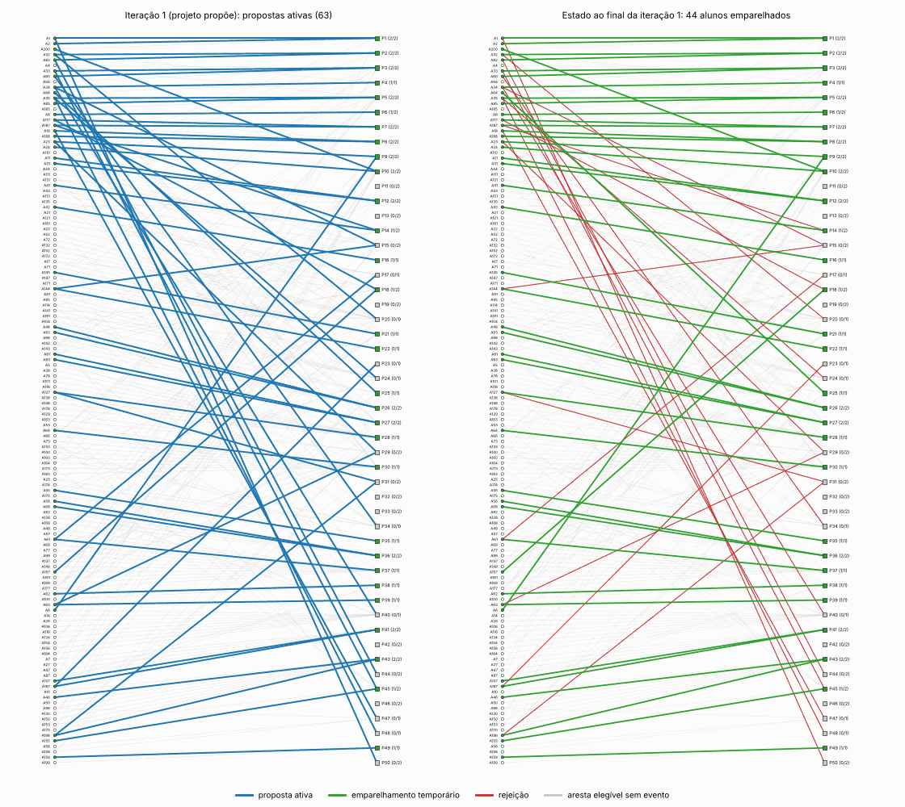

# Projeto 2: alocação estável de alunos em projetos

Teoria e Aplicação de Grafos, Turma A, 2026/2, Prof. Díbio, Universidade de Brasília.

Emparelhamento estável máximo de 200 alunos em 50 projetos (80 vagas) com variações do algoritmo de Gale-Shapley, dez iterações em laço com caminhos alternados e visualização colorida do grafo bipartido.



## Estrutura

```
TAG-2026-2-proj2/
├── README.md
├── requirements.txt
├── .gitignore
├── data/
│   └── entradaProj2.26TAG.txt            # projetos, vagas, requisitos, alunos e preferências
├── notebook/
│   └── projeto2.ipynb                    # código comentado, simulações e verificações
├── figuras/                              # grafo de entrada, iterações, GIFs, matriz e alocação final
├── resultados/                           # tabelas em CSV, entre elas a matriz final
└── verificacao/
    └── verifica.py                       # conferência independente do resultado
```

## Como rodar

```bash
pip install -r requirements.txt
jupyter notebook notebook/projeto2.ipynb
```

Abra o notebook a partir da pasta `notebook` e use Run All. A entrada é lida de `../data/entradaProj2.26TAG.txt`. No Google Colab, execute a primeira célula de código e escolha o arquivo de entrada quando o botão de envio aparecer. Os parâmetros ficam na primeira célula de código: número de iterações, regra de desempate, limite do caminho aumentante, se os gráficos devem ser desenhados (`MOSTRARGRAFICOS`) e se as figuras e tabelas devem ser salvas (`SALVARSAIDAS`).

## O que o notebook gera

Quando o notebook roda do início ao fim, ele salva sozinho as figuras na pasta `figuras` (o grafo de entrada, uma figura para cada uma das dez iterações das duas versões, um GIF de cada versão, a matriz final, a alocação final e alguns gráficos de apoio) e as tabelas na pasta `resultados`. A alocação final fica em `resultados/matriz-final.csv`. No Colab os arquivos ficam na sessão, e a última célula da etapa 9 baixa um zip com tudo. Nada no notebook usa número aleatório, então duas execuções dão o mesmo resultado.

## Como conferir o resultado

O script `verificacao/verifica.py` lê a entrada e o `matriz-final.csv` por conta própria e confere as vagas, as listas elegíveis, as duas classificações da matriz e os pares bloqueantes. Para rodar, use `python verificacao/verifica.py` na pasta do projeto (ele precisa do `scipy`).

## Resultado

A proposta final, com a lista de preferência do projeto conduzindo as propostas, aloca 60 dos 134 alunos que têm alguma opção elegível, em 41 dos 50 projetos. Dos alunos alocados, 40 ficaram na primeira escolha, 9 na segunda e 11 na terceira. Não há par bloqueante no sentido fraco. As versões em que o aluno propõe e em que o projeto propõe terminam a fase 1 na mesma alocação, porque com essas listas existe um único emparelhamento estável, e a fase 2 parte dela, então o resultado final também é igual.

## O que foi feito e qual variação foi usada

### 1. O problema

Uma universidade oferece 50 projetos que somam 80 vagas, e 200 alunos se candidataram. Cada aluno indica até três projetos em ordem de preferência e tem uma nota agregada inteira em {3, 4, 5}. Cada projeto tem um número de vagas e uma nota mínima exigida. Queremos uma alocação estável, isto é, sem nenhum par aluno-projeto que prefira estar junto em vez de ficar com o que recebeu, e com o maior número possível de alunos alocados, porque quanto mais alunos alocados mais projetos conseguem ser realizados.

Esse é o problema de alocação de alunos a projetos (Student-Project Allocation, SPA) estudado por Abraham, Irving e Manlove (2007). O artigo propõe dois algoritmos, um orientado ao aluno (student-oriented), que devolve a alocação estável melhor para os alunos, e um orientado ao professor (lecturer-oriented), que devolve a alocação estável melhor para o lado dos projetos. No arquivo de entrada não há professores com limite próprio de carga, então cada projeto equivale ao único projeto de um orientador cujo limite é o próprio número de vagas. Com isso a camada dos professores não tem efeito e o problema fica igual ao problema de Hospitais e Residentes: alunos são os residentes e projetos são os hospitais, cada um com capacidade. Os dois algoritmos do artigo se reduzem, nesse caso, às duas versões clássicas do Gale-Shapley com capacidades.

### 2. Modelagem em grafos

Montamos um grafo bipartido em que um lado é o conjunto de alunos e o outro é o conjunto de projetos. Existe uma aresta (aluno, projeto) quando o aluno colocou o projeto na sua lista e a nota dele atinge o requisito do projeto. Pares barrados pela nota não viram aresta. Um emparelhamento é um conjunto de arestas em que cada aluno aparece no máximo uma vez e cada projeto aparece no máximo tantas vezes quanto suas vagas (um emparelhamento com capacidades).

A preferência dos alunos é a ordem que eles indicaram. O arquivo não traz preferência dos projetos, então ela é construída a partir da nota: nota maior é melhor. Como só existem três valores de nota, há muitos empates. Para rodar o Gale-Shapley precisamos de uma lista estrita, então os empates são desfeitos de forma determinística, sem sorteio: entre alunos de mesma nota vem primeiro quem colocou o projeto em posição melhor na sua lista, e se ainda assim empatar vem o menor código de aluno. Essa lista estrita é a Lista de Preferência do Projeto que aparece na matriz final. A parametrização `DESEMPATE` permite testar outras regras.

### 3. O que significa estável aqui

Um par (aluno a, projeto p) que não está no emparelhamento é um par bloqueante quando a prefere p ao projeto que recebeu (ou ficou sem nada) e p tem vaga livre ou prefere a a algum aluno que já recebeu. Um emparelhamento sem pares bloqueantes é estável. Usamos duas versões da definição.

Na estabilidade estrita, "p prefere a" significa estar à frente na lista estrita de p, incluindo o desempate. Na estabilidade fraca, p só prefere a quando a nota de a é estritamente maior que a de algum aluno de p. A segunda é a definição fiel aos dados, porque dois alunos com a mesma nota são equivalentes para o projeto e o desempate foi uma escolha nossa para poder rodar o algoritmo. Todo emparelhamento estável no sentido estrito também é estável no sentido fraco, mas não o contrário.

### 4. A variação do algoritmo (descrição pedida no enunciado)

**Pré-processamento.** Lemos o arquivo, descartamos preferências por projetos que não existem, descartamos repetições dentro da mesma lista e retiramos as arestas barradas pela nota mínima. Em seguida construímos a lista de cada projeto, ordenada por nota com o desempate descrito acima.

**Laço de 10 iterações.** Cada iteração tem duas fases, executadas sempre na mesma ordem e sem nenhum sorteio.

*Fase 1, uma rodada de aceitação adiada (Gale-Shapley com capacidades).* Existem duas versões e as duas são simuladas.
- Aluno propõe: cada aluno livre que ainda tem projeto não testado propõe ao próximo projeto da sua lista. Cada projeto junta as propostas novas com os alunos que já segurava, fica com os melhores até o limite de vagas (emparelhamento temporário) e rejeita o resto. Quem é rejeitado volta a ficar livre.
- Projeto propõe: cada projeto com vaga livre propõe aos próximos alunos da sua lista, um por vaga livre. Cada aluno junta as propostas recebidas com o projeto que já segurava, fica com o melhor segundo a sua própria ordem e rejeita os demais. A vaga do projeto rejeitado volta a ficar livre.

Em termos de caminhos alternados, uma proposta é uma aresta fora do emparelhamento e uma rejeição ou substituição é uma aresta do emparelhamento que sai. Quando um aluno livre propõe, desloca alguém, e o deslocado propõe em seguida, estamos percorrendo um caminho alternado que cresce um passo por iteração e que termina quando alguém encontra vaga livre (o emparelhamento aumenta em um) ou quando alguém esgota a lista. Por isso, a cada iteração, o ponto de partida são os alunos que ficaram sem emparelhamento na iteração anterior.

*Fase 2, caminhos alternados aumentantes.* Em toda iteração, depois da rodada da fase 1, o algoritmo tenta aumentar o emparelhamento: parte dos alunos que ficaram sem projeto no fim da iteração anterior e continuam livres e procura caminhos alternados que terminam em um projeto com vaga livre. Enquanto a fase 1 ainda tem propostas pendentes, a tentativa é *parcial*: o caminho só pode usar arestas que a fase 1 já percorreu, e a estabilidade fraca só é conferida entre elas, o que mantém válidas as propostas seguintes do Gale-Shapley. Nesse período ela em geral não acha nada, porque as próprias propostas já são os passos de caminhos alternados. Quando a fase 1 esgota, o emparelhamento é estável no sentido estrito, mas ainda pode haver alunos livres que cabem se alguém de nota igual se mover para outro projeto. A tentativa passa a ser *completa*: o caminho pode usar qualquer aresta elegível e a estabilidade fraca é conferida no grafo inteiro. A busca é em profundidade com aprofundamento iterativo, então o caminho mais curto é testado primeiro, e os alunos são percorridos em ordem de código, o que a torna determinística. Cada caminho candidato é aplicado em uma cópia do emparelhamento e só é aceito se a cópia respeitar as vagas e não tiver nenhum par bloqueante no sentido fraco. Assim o emparelhamento cresce sem perder a estabilidade. Cada iteração aceita no máximo um caminho, para que a evolução possa ser acompanhada passo a passo.

**Critério de parada.** O laço roda as 10 iterações pedidas. Ele fica estacionário quando uma iteração não tem propostas na fase 1 e nenhum caminho aumentante estável na fase 2. O programa avisa se isso não tiver acontecido até a décima iteração.

**Projetos sem alunos.** Todo projeto realizado precisa de pelo menos um aluno. Um projeto que termina com zero alunos é marcado como não realizado.

**Resposta final.** Como pede o enunciado, a proposta final é a do lado do projeto (a lista de preferência do projeto conduz as propostas), seguida da fase 2. A versão em que o aluno propõe também é simulada e mostrada, e as duas são comparadas.

**Custo.** Na fase 1 cada aresta é proposta no máximo uma vez, então o custo total é linear no número de arestas. A fase 2 é uma busca com limite de comprimento (`MAXPASSOSCAMINHO`), porque encontrar o maior emparelhamento estável quando há empates é um problema difícil em geral.

### 5. Inconsistências no arquivo de entrada e o que fizemos

- Cinco alunos citam projetos que não existem: A2 (P51), A39 (P53), A51 (P52), A95 (P53) e A108 (P54). Essas preferências são ignoradas.
- Onze alunos repetem um projeto na própria lista (A63, A64, A67, A89, A118, A119, A133, A141, A163, A164 e A167). Vale a primeira ocorrência e a repetição é ignorada, então esses alunos ficam com menos de três opções.
- A linha de A177 não tem espaço entre ")" e "(5)". A leitura por expressão regular tolera isso.
- Trezentos pares aluno-projeto são barrados porque a nota do aluno é menor que o requisito do projeto. Eles não entram no grafo, mas aparecem na figura do grafo de entrada.
- A ordem de escolha mostrada na matriz final é a posição do projeto na lista original do aluno. Se o primeiro projeto de um aluno não existe, o segundo continua sendo contado como segunda escolha.

## Integrantes

| Integrante | Matrícula |
|---|---|
| Gabrielly Batista de Freitas | 251004400 |
| Helena Miranda Longo | 251004302 |

## Referência

Abraham, D.J., Irving, R.W. e Manlove, D.F. (2007). Two algorithms for the student-project allocation problem. Journal of Discrete Algorithms 5(1), pp. 73-90.